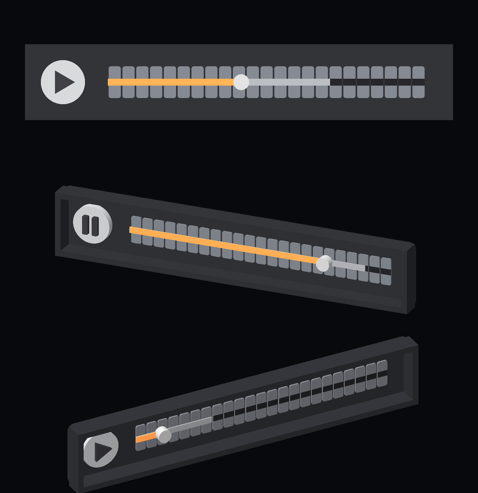

# Video.js × spatial CSS

An experiment: a [`@videojs/html`](https://videojs.org) player whose controls are 3D models, placed and animated with the
[spatial CSS developer preview](https://webkit.org/blog/18621/introducing-spatial-css-a-developer-preview/) in Safari on
visionOS 27.3 ([draft spec](https://drafts.csswg.org/css-spatial-1/)).

There is a play button and a timeline. Both are ordinary Video.js components sitting inside `<video-player>` next to the
media element; they just render `<model>` elements instead of HTML.



_A software render from `models/preview.py`. It checks the geometry and layout, not how Safari draws it._

> **Nothing here has been run on visionOS.** It was written against the blog post and the draft spec, on a machine that
> can't render either `<model>` or a portal. The flat fallback and the wiring to the player are tested; the 3D part is a
> first guess. The lab panel on the page exists to find out where the guess is wrong.

## Run it

```bash
pnpm install
```

```bash
pnpm dev
```

Then, in Safari on Vision Pro or the visionOS Simulator:

1. Turn on **Settings › Apps › Safari › Advanced › Feature flags › CSS Portals**.
2. Open the dev server's URL (the Simulator can use `localhost`; a headset needs the Network URL).

Any other browser shows flat controls driven by the same components.

## How it works

```html
<video-player>
  <media-container>
    <video src="…"></video>

    <spatial-stage>                              <!-- spatial: portal -->
      <spatial-play-button></spatial-play-button>   <!-- puck + play + pause models -->
      <spatial-time-slider></spatial-time-slider>   <!-- 23 tiles + buffer + fill + thumb models -->
    </spatial-stage>
  </media-container>
</video-player>
```

- **Components hold state, CSS holds space.** Each component subscribes to the player store and writes attributes and
  custom properties (`data-active`, `--amount`, `--press`) onto its models. Every transform, transition and light lives
  in [`public/styles/spatial.css`](public/styles/spatial.css).
- **The tray is the stage.** `portal-transform: auto` fits the portal's contents to its box, and the spec measures those
  contents ignoring transforms. So one model, the tray, is built to enclose everything else.
- **The timeline is cut into tiles.** The spec says a portal must not give the page precise pointer coordinates, so a
  click can't be turned into a position. Which tile was hit is the position.
- **Models are generated.** [`models/build.py`](models/build.py) writes the USDZ files, two HDR environment maps and
  `public/styles/layout.css`, so mesh sizes and CSS offsets come from one table.

## The lab

Below the player:

- **Support** lists which parts of the draft spec the browser parses.
- **Switches** try one feature each, and are saved in the URL: orbit, `portal-transform`, environment maps (including one
  made live from the video frame), anchoring the glyphs to an empty inside the puck model, `position: spatial-absolute`,
  hoisting the models to be direct children of the portal, and `requestVolumetricScene()`.
- **Events** logs what models in the portal report. **Copy report** puts the lot on the clipboard.

## What I'd most like to know

1. Do the models show up, at a sensible size, when nested inside the component elements? If only the tray shows, does
   “Hoist models” fix it?
2. Does clicking a model fire `click`? What do `clientX`/`offsetX` look like in the event log?
3. Does dragging the thumb do anything, or does only tile-clicking work?
4. Do transforms transition smoothly when a custom property changes?
5. Does `translateX()` grow to the right and `translateZ()` come towards you? Do bars scale from their left end?
6. Which environment switches change the lighting? Does “the video itself” work at all?
7. What does “Take the controls out of the page” do, and do the controls still drive the video from out there?

## Rebuilding the models

```bash
pip install usd-core pillow numpy
```

```bash
pnpm models
```

```bash
python3 models/preview.py
```

## Layout

| Path | What |
| --- | --- |
| `src/spatial-*.ts` | The stage and the two controls |
| `src/lab.ts`, `src/ambient.ts` | The lab panel and the video-as-lighting experiment |
| `public/styles/spatial.css` | The spatial skin |
| `public/styles/layout.css` | Generated sizes shared by models and CSS |
| `public/models`, `public/env` | Generated USDZ models and HDR maps |
| `models/` | Generator and software preview |

The stylesheets are plain files under `public/` because they use at-rules and properties no CSS tooling knows yet.
